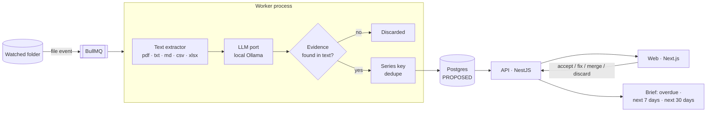

# life-os

**Reads personal paperwork — contracts, insurance policies, card statements,
bills — finds what it obliges you to do and by when, and shows it in a daily
brief.**

The central idea is the **Obligation**: something to do or pay, with a date,
and with the literal passage of the source document that justifies it. A
language model proposes obligations; a human accepts them. Nothing the model
says counts until someone has looked at it.

It is a single-user tool built to be used every day, and a backend-focused
portfolio piece: hexagonal architecture, a local LLM behind a port, an eval
set for the extraction, and accounts with hand-rolled TOTP two-factor auth.

---

## Run it

Requirements: Node 24, Docker, and [Ollama](https://ollama.com) with a model:

```bash
ollama pull qwen2.5:7b-instruct
```

```bash
cp .env.example .env          # WATCH_DIR, AUTH_ENCRYPTION_KEY, WATCH_OWNER_EMAIL
npm install && npm run web:install
npm run db:up && npm run db:deploy
npm run dev                   # worker + API + web together, or separately:
npm run worker                #   watched folder + extraction
npm run api                   #   http://127.0.0.1:3010/api
npm run web                   #   http://localhost:3011
```

Open http://localhost:3011 and create the first account (sign-up closes by
itself after that), enable two-step verification under Security, put that
email in `WATCH_OWNER_EMAIL` and restart `npm run dev`: only then does the
worker start watching the folder. Drop a PDF in `WATCH_DIR` and review it at
`/review`.

`npm run llm:smoke` checks the model against a sample text, without database
or queue.

---

## The system



The API and the worker are **separate processes**. The API never talks to the
model: extraction is slow (a 7B model on CPU takes from seconds to minutes per
page), so it runs in the background and the brief only ever reads what is
already in the database.

---

## Decisions worth reading

### Nothing counts without human review

Everything the model proposes is stored as `PROPOSED` and stays out of the
brief until a person accepts it, and accepting requires a date. The model is
treated as a fast, unreliable clerk: useful for finding candidates, never the
source of truth.

### No evidence, no obligation

The model must quote the passage that justifies each obligation (up to three
literal fragments — the due-date line and the total, for example). If a quote
is not found in the document, after normalising whitespace and punctuation,
the proposal is discarded. Amounts and dates must be written in the text: if
the model computes a total or swaps day and month, the field is left empty and
completed during review. A date must also appear inside the cited evidence,
because a statement contains several (closing date, next closing, due date).

### Relative deadlines count from the document's date

"12 months from issue" is counted from the issue date written in the
document, not from the day the PDF was processed. And a relative deadline has
to be written as one — "on the 5th of each month" is a recurrence, not "one
month and five days from issue".

### One series, not one duplicate per month

Each month's statement for the same card is recognised as the same series
(counterparty + kind + title, ±3 days) and adds evidence instead of creating a
new obligation. Completing a monthly, quarterly or yearly obligation creates
the next one.

### The brief is computed live

No cron job and no "run at 8 am": the brief is a query over accepted
obligations at request time. It does not depend on the machine being on at a
given hour.

### The model is local by default, and remote is opt-in

This is financial data. The LLM runs locally through Ollama behind an
OpenAI-compatible port. If `LLM_BASE_URL` points outside the machine, or the
model is an Ollama `-cloud` model (which runs remotely even when requested
from the local endpoint), the system **refuses to start** unless
`LLM_ALLOW_REMOTE=true` is set on purpose. The API listens only on
`127.0.0.1` and rejects requests whose `Host` is not `localhost`/`127.0.0.1`
(DNS rebinding).

### Opaque sessions in Postgres, not JWT — [ADR 0001](docs/adr/0001-sesiones-opacas.md)

A sibling project uses short-lived JWTs with rotating refresh tokens, which is
right for a horizontally scaled multi-tenant API. Here the forces are
different: one backend, immediate revocation, a visible list of devices, and
an intermediate "password passed, code pending" state. So the cookie carries
32 random bytes, and the database stores only their SHA-256. Signing out of
one device, all of them, or changing the password takes effect at once.

### Two-step verification, implemented by hand

TOTP (RFC 6238) written from scratch and tested against the RFC's own test
vectors. The secret is encrypted with AES-256-GCM, there are 10 single-use
recovery codes (only their hashes are stored), and a code cannot be used twice
— the same code in two concurrent requests succeeds once, enforced with a
conditional `UPDATE`. A password alone yields a session that can only finish
the login.

### Attempt limits that a burst cannot outrun

Limits live in Redis and the attempt is **reserved before** it is verified
(`INCR` + `EXPIRE NX` in a `MULTI`), so a parallel burst cannot try more than
the limit: 5 per email and 20 per IP every 15 minutes, then `429` with
`Retry-After`. Second-factor codes have their own budget that does not reset
by re-entering the password. Unknown email and wrong password produce the same
message and both verify an argon2 hash, so accounts cannot be enumerated.

### Every user sees only their own data

Documents and obligations are scoped by owner, and someone else's id answers
`404`, exactly like an id that does not exist. Mutating requests must carry an
`Origin` from `WEB_ORIGINS` (on localhost, `SameSite=Lax` does not separate
ports), and `?next=` redirects are only followed within the same origin.

---

## Layout

```
src/
├─ domain/            # pure: Obligation, brief, evidence matching, date resolution,
│  │                  # series keys, extraction schema; auth rules (TOTP, sessions)
│  └─ ports/          # LLM, text extractor, repositories, queue, clock, secret box
├─ application/       # use cases: ingest, extract, review, complete, brief, auth
├─ infrastructure/    # adapters: OpenAI-compatible LLM, file text extractor,
│                     # Prisma repositories, BullMQ, folder watcher, crypto
├─ api/               # NestJS controllers, host guard, error filter
├─ worker/            # the background process: watcher + extraction pipeline
└─ eval/              # extraction eval runner and scoring
apps/web/             # Next.js app (reaches the API through a same-origin rewrite)
eval/                 # eval cases and their expected obligations
docs/adr/             # architecture decisions
docs/superpowers/     # design specs and implementation plans
```

The dependency rule is the usual one: `domain` imports nothing, `application`
depends only on `domain` and its ports, and `infrastructure` implements them.

### Screens

| Route | Purpose |
|---|---|
| `/brief` | Overdue, next 7 and 30 days, and how many proposals await review |
| `/review` | Each proposal with its highlighted evidence and the document; fix, accept, merge or discard |
| `/obligations` | All of them, filtered by status and kind; mark as done |
| `/documents` | What came in, its state, why it failed; reprocess |
| `/settings/security` | Two-step verification, devices with an open session, password, activity log |
| `/login`, `/register` | Access; with 2FA, `/login/mfa` asks for the code or a recovery code |

---

## Tests and evals

```bash
npm test                 # domain and use cases: no database, no Docker, no LLM
npm run typecheck
npm run db:smoke         # round trip against real Postgres, including isolation between users
npm run web:build
npm run eval:extraction -- <label> [case ...]
```

The unit suite (~180 tests) runs in seconds with no infrastructure: the
domain is pure and the use cases run against in-memory fakes of the ports.

**The extraction has its own eval.** `eval/cases` holds sample documents and
`eval/expected.json` the obligations a careful reader would extract from each.
`eval:extraction` runs the configured model over them and scores every
expected item on kind, due date, recurrence and amount, and counts extra
proposals that should not exist. Prompt or model changes are judged by that
score, not by eyeballing one document.

An end-to-end check with synthetic PDFs (a utility bill, a card statement, a
medical appointment, an insurance policy and an already-paid receipt) found
four real bugs — a watched folder hidden by `.gitignore` rules, a timeout that
aborted the model while it was still loading, a date taken from the wrong line,
and "day 5 of every month" read as a relative deadline. Each one now has a
test.

---

## What this deliberately does not have

- **OCR.** Most paperwork arrives as PDFs with a text layer. Scans would go
  behind the existing `TextExtractor` port.
- **Gmail, Google Drive and Calendar.** Designed (login with Google via OIDC +
  PKCE opens the door to them) but not built.
- **Notion sync.** Planned as bidirectional, with per-field conflict resolution
  by `last_edited_time`.
- **User-defined structure and rules.** Categories and fields are fixed for
  now.

---

## Developing notes

- On CPU, a 7B model takes from 20 seconds to a couple of minutes per page,
  and loading it cold from a slow disk can take several minutes. That is why
  the per-request timeout is 30 minutes (`LLM_TIMEOUT_MS`): cutting it earlier
  makes Ollama abort the load and every retry starts from zero.
- If Ollama picks a GPU that hangs while loading ("timed out waiting for
  llama-server to start"), a CPU-only variant shares the same model file:

  ```bash
  printf 'FROM qwen2.5:7b-instruct\nPARAMETER num_gpu 0\n' > Modelfile.cpu
  ollama create qwen2.5:7b-instruct-cpu -f Modelfile.cpu
  # then in .env: LLM_MODEL=qwen2.5:7b-instruct-cpu
  ```

- `WATCH_DIR` can point to a test folder inside the repo (`.local/inbox`,
  ignored by git).
- Environment: `AUTH_ENCRYPTION_KEY` (32 bytes, base64), `WATCH_OWNER_EMAIL`
  (who owns what arrives through the folder), `ALLOW_SIGNUP` (`first` by
  default: only the first account; `true` open, `false` closed), `WEB_ORIGINS`,
  `TIME_ZONE` (IANA zone that defines "today" for due dates; `UTC` by default).

---

## Stack

TypeScript · NestJS 11 · Prisma 7 · PostgreSQL · BullMQ + Redis · Next.js ·
Ollama (any OpenAI-compatible endpoint) · node:test.

## Further reading

- `docs/adr/` — architecture decisions (in Spanish).
- `docs/superpowers/specs/` and `docs/superpowers/plans/` — design documents
  and implementation plans for the MVP and for authentication.
